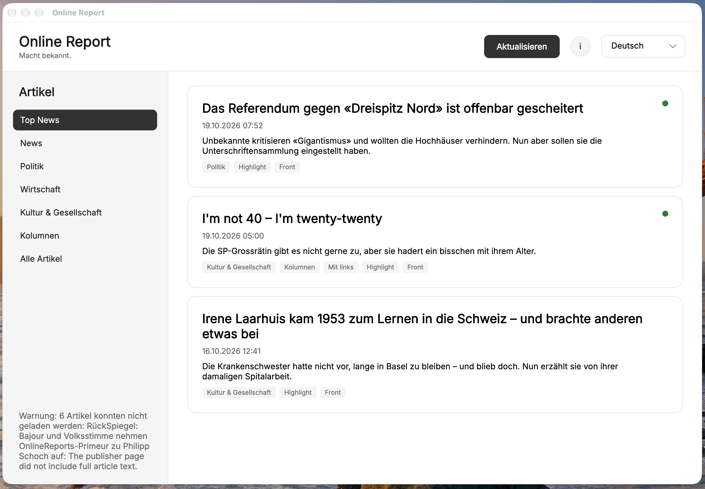

# OnlineReports Client

[OnlineReports](https://www.onlinereports.ch/) is a Basel-based local news provider. This cross-platform native desktop client reads its public feed and article pages without embedding a browser. Version 2 is an Avalonia desktop app for Windows, macOS and Linux.




## Features
The product brief is in [features/features.md](features/features.md). The client opens on Top News with the three newest stories, lists every archived story of a section in News, Politics, Economy, Culture & Society and Columns, and shows every available story under All articles at the end of the menu, reads article text natively, and keeps downloaded articles available offline. Feed updates cache the first main image of each article (also filling in images missing from earlier updates) and mark newly added stories; the sync information reports the last update time and number of feed articles loaded. German is the default interface language, with French and English also available. The app follows the operating system's light or dark appearance.

The public RSS feed is `https://onlinereports.ch/api/rss-feed`. Article metadata and full text are stored under the user's local application data folder in `OnlineReports/articles.json`.

## Run

Prerequisite: .NET 10 SDK.

```sh
dotnet run --project src/OnlineReports.Client
```

The first launch updates the feed before showing the stories. If the feed is unavailable, previously archived stories remain available and the sync status explains the problem.

The Jump Bit app icon is applied to Windows executables and the window. On macOS the Dock icon is also set at startup, so it appears with `dotnet run`. Publish a macOS app bundle with its ICNS Dock icon using:

```sh
dotnet publish src/OnlineReports.Client -c Release -r osx-arm64 --self-contained
```

The bundle is written to `src/OnlineReports.Client/bin/Release/net10.0/osx-arm64/publish/OnlineReports.app`. Use `-r osx-x64` to build for Intel Macs.

`assets/jumpbit-app.icns` is generated from `assets/jumpbit-app-1024.png` with the macOS icon margin. After changing the artwork, regenerate it on a Mac with `scripts/build-macos-icon.sh`.

## Test

```sh
dotnet test tests/OnlineReports.Client.Tests
```
